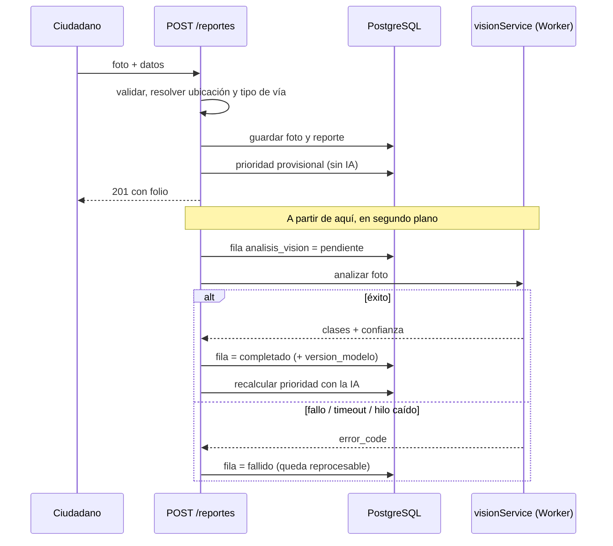

# Visión artificial, clasificación vial y motor de prioridad — Hito 3

> Bloque listo para pegar en el informe final (rúbrica B2 y B5). Los datos marcados con **[COMPLETAR]** no se pueden deducir del repositorio: hay que medirlos o anotarlos antes de entregar.

## 1. Alternativas evaluadas y justificación del descarte

El motor de IA tiene un rol acotado por contrato: **corrobora, nunca decide** la prioridad (aporta como máximo +1 punto de 10 y jamás resta). Eso permitió elegir la opción más simple de operar para un prototipo evaluable por terceros.

| Criterio | Google Cloud Vision / Gemini | Hugging Face (Inference API) | **TensorFlow.js local (MobileNetV2)** |
|---|---|---|---|
| Qué es | API de pago / LLM multimodal general | API alojada de modelos de terceros | Modelo propio ejecutado en el servidor |
| Requisitos para usarlo | Cuenta con facturación habilitada | Cuenta, token y cuota del proveedor | Ninguno externo (el modelo va en el repositorio) |
| Experiencia del equipo | Bloqueado: la facturación rechazó las tarjetas prepago y la cuota gratuita quedó en cero | Cuota gratuita en cero y fallos de red/proveedor | Funciona sin red ni claves |
| Reproducibilidad (el docente ejecuta el proyecto) | Baja: necesita credenciales y cobro | Baja: necesita token y depende del proveedor | **Alta**: `npm install` y listo |
| Disponibilidad | Depende de red, cuota y del proveedor (el código previo ya necesitaba reintentos ante respuestas 503) | Ídem | Depende solo del propio servidor |
| Resultado | Texto/JSON generado: no determinista y hay que validarlo | Depende del modelo elegido | **Determinista**: misma foto, mismo resultado |
| Privacidad | La fotografía sale a un tercero | La fotografía sale a un tercero | **La fotografía no sale del servidor** |
| Especialización | General: no está entrenado para baches viales de Chile | Ídem | Entrenado con fotos de baches (3 clases) |
| Costo recurrente | Por solicitud, más allá de la cuota gratuita | Por solicitud / suscripción | Solo CPU del servidor |
| Latencia | Red + proveedor | Red + proveedor | Local: ver medición en §2 |

**Decisión:** TensorFlow.js local, porque (1) el producto debe poder ejecutarse en el equipo de quien evalúa sin cuentas ni cobros, (2) un fallo del proveedor no puede condicionar la recepción de un reporte ciudadano y (3) las fotos pueden mostrar personas o vehículos y es preferible no enviarlas a terceros.

**Desventaja asumida:** menor precisión y generalidad que un modelo de gran escala, y ninguna estimación de severidad (ver §3). Es aceptable porque la IA no decide la prioridad.

> Para respaldar la columna "Experiencia del equipo" en el informe, **[COMPLETAR]** con fechas y capturas de los bloqueos (facturación rechazada, cuota en cero, errores de red) y enlazarlas desde la bitácora.

## 2. Ficha del modelo actual

| Campo | Valor |
|---|---|
| Origen | Teachable Machine (proyecto de imágenes), exportado como TensorFlow.js. Metadatos: `@teachablemachine/image 0.8.4-alpha2`, `tm 2.4.19`, formato `tfjs-layers 1.7.4`. Exportado el 2026-11-11 (`metadata.json`) |
| Arquitectura | Extractor MobileNetV2 (bloques `expanded_conv` … `block_16` y `Conv_1`) → `GlobalAveragePooling2D` (1280 características) → `Dense(100, ReLU)` → `Dense(3, softmax)` |
| Parámetros | 538.608 (263 tensores), 2.154.432 bytes en `weights.bin`, `float32` sin cuantizar |
| Entrada | Imagen RGB 224×224, normalizada como `píxel / 127,5 − 1` (la misma de Teachable Machine) |
| Clases | `Bache`, `Calle Sana`, `Otro` |
| Preprocesamiento | `sharp`: recorte centrado a 224×224, sin canal alfa, conversión a sRGB (cubre escala de grises y CMYK), límite de 50 Mpx por imagen |
| Ejecución | `@tensorflow/tfjs` 4.x en CPU, dentro de un `worker_threads` reutilizable, con una sola inferencia a la vez |
| Versión registrada | `analisis_vision.version_modelo` = `nombre@fecha-de-exportación+sha256:<12 primeros caracteres de los pesos>`; cambia sola si se reemplazan los pesos |
| Licencias | `@tensorflow/tfjs`, `sharp` y los pesos de MobileNetV2 se distribuyen bajo Apache 2.0 según sus repositorios oficiales **[VERIFICAR en el informe]**. Las condiciones de uso de los modelos exportados desde Teachable Machine **[VERIFICAR]** en <https://teachablemachine.withgoogle.com/faq> y citar la fecha de consulta |
| Requisitos | Node.js ≥ 20; ~2 MB de pesos en el repositorio; sin GPU |
| Rendimiento | Carga inicial: **[COMPLETAR]** s · inferencia con el modelo ya cargado: **[COMPLETAR]** ms (medir con `node scripts/probar-vision.js`) |

### Traducción al dominio

| Clase del modelo | `etiqueta` guardada | Efecto en el motor de prioridad |
|---|---|---|
| Bache | `bache` | Con confianza ≥ 0,6 puede corroborar (ver §3, limitación de severidad) |
| Calle Sana | `ninguno` | Sin aporte + advertencia `revisar_fotografia` |
| Otro | `ninguno` | Sin aporte + advertencia `revisar_fotografia` (la foto puede no ser de una calzada) |

Se guardan las **tres** clases con su confianza en `analisis_vision.detecciones` (`etiqueta`, `clase_modelo`, `confianza`, `caja: null`). Si la confianza de la mejor clase es baja, se informa tal cual y es el motor quien declara "confianza insuficiente: sin aporte".

### Flujo asíncrono: nunca se pierde un reporte por culpa de la IA

Garantías (todas cubiertas por pruebas automáticas en `test/reportService.test.js` y `test/visionService.test.js`):

- La respuesta `201` se entrega **antes** de iniciar la inferencia; cada etapa posterior está aislada y registra su error sin propagarlo.
- La base de datos actúa como cola: la fila `pendiente` existe antes de analizar, así que si el servidor cae queda rastro.
- Fallar a mitad de camino deja la fila en `fallido` con un `error_code`, y el análisis se puede repetir con `POST /api/v1/reportes/:id/analisis-vision` (crea una fila nueva y conserva el historial).
- Si la visión está apagada (`VISION_ENABLED=false`) no se crea ninguna fila.

| `error_code` | Significado |
|---|---|
| `VISION_TIMEOUT` | Superó `VISION_TIMEOUT_MS` (30 s por defecto) |
| `VISION_PREPROCESO_FALLO` | Foto corrupta, inexistente o ilegible |
| `VISION_WORKER_ERROR` | El modelo falló en la inferencia (el hilo sigue sano) |
| `VISION_WORKER_CAIDO` | El hilo de IA se cayó; se reemplaza solo en el siguiente análisis |
| `VISION_SATURADO` | Había más de `VISION_MAX_COLA` análisis en espera |
| `VISION_DESHABILITADA` | Se pidió un reproceso con la visión apagada |

### Endpoints (contrato 7.5)

| Método y ruta | Roles | Respuesta |
|---|---|---|
| `GET /api/v1/reportes/:id/analisis-vision` | inspector, administrador municipal, superadministrador | `200` lista (puede ser vacía) · `404` si el reporte no es visible |
| `GET /api/v1/analisis-vision/:id` | ídem | `200` · `404` |
| `POST /api/v1/reportes/:id/analisis-vision` | administrador municipal, superadministrador | `202` + cabecera `Location`; `404` · `409` (sin foto, o ya hay uno en curso) · `503` (visión apagada) |

El ámbito municipal se verifica en SQL: un funcionario nunca ve análisis de otra municipalidad (responde `404`, no `403`).

## 3. Limitaciones reales

**Del modelo**

- **Clasifica la foto completa en tres clases.** No localiza el bache (no hay *bounding boxes*; `caja` es siempre `null`) ni mide profundidad o diámetro, y una foto con varios baches recibe una sola etiqueta.
- **No estima severidad.** Por eso `severidad_sugerida` es `null`. Antes se fijaba en "media", lo que generaba falsas advertencias de discrepancia con lo declarado por el ciudadano. Consecuencia: con las reglas actuales (el aporte de la IA exige severidad "alta"), **hoy la IA no suma puntos**: corrobora el tipo de desperfecto y advierte cuando no ve ninguno. Si el equipo quiere que sume, debe cambiar la regla en `priorityRules.js` (subir `VERSION_REGLAS`) o reentrenar con clases de severidad; es una decisión de negocio, no un error.
- **Datos de entrenamiento acotados.** Cantidad de fotos por clase y origen: **[COMPLETAR]**. No hay conjunto de prueba independiente ni métricas de exactitud, precisión y exhaustividad medidas con fotos nuevas: **[COMPLETAR o declarar la ausencia]**.
- **Diferencias con calles de Chile.** Pavimentos distintos (asfalto, hormigón, adoquín, ripio o tierra), tapas de alcantarilla, parches y reparaciones, pasos de cebra y sombras pueden confundirse con baches si no estuvieron en el entrenamiento.
- **Iluminación y cámara.** Noche, contraluz, charcos, lluvia, reflejos, fotos desenfocadas o tomadas desde lejos o con mucha inclinación reducen la confianza.
- **Modelo estático.** No aprende de las correcciones de los funcionarios; mejorarlo exige reentrenar y reemplazar los pesos.

**Mitigaciones de diseño:** la IA nunca decide; toda decisión queda como `motivos` explicables y versionados (`version_reglas`); un funcionario revisa; las advertencias (`revisar_fotografia`) señalan los casos dudosos.

**Del tipo de vía (OpenStreetMap)**

**Del tipo de vía (Evaluación de OpenStreetMap)**

- Evaluamos utilizar la etiqueta `highway` devuelta por Nominatim/OSM para automatizar este campo. Sin embargo, al ser una jerarquía funcional **colaborativa**, no coincide con la clasificación legal estricta de la OGUC chilena (art. 2.3.1).
- Forzar una tabla de equivalencias (por ejemplo, mapear `highway=service` que en OSM es acceso a predios, con la "vía de servicio" de la OGUC) habría introducido datos imprecisos en la base de datos municipal.
- **Decisión técnica:** Acordamos con el equipo dejar la integración de clasificación vial automática fuera del alcance por tiempo y fiabilidad técnica, conservando en base de datos `clasificacion_vial = null` y `clasificacion_vial_estado = 'pendiente'` para no inventar categorías por defecto.
- La vía se toma del objeto más cercano al punto: se descarta (`ambigua`) si el nombre no coincide con la calle de la dirección o si el GPS tiene más de 50 m de error.
- Cada clasificación `confirmada` guarda como fuente el identificador del elemento OSM, para que pueda verificarse. Se puede apagar con `CLASIFICACION_VIAL_ENABLED=false`. La equivalencia debería validarla un humano con criterio vial **[COMPLETAR: quién la validó y cuándo]**.

## 4. Privacidad y datos personales

**Datos que trata el sistema:** fotografías (pueden mostrar rostros, patentes o fachadas), coordenadas exactas del reporte, dirección detectada, descripción libre del ciudadano; correos y hashes de contraseña de los funcionarios; registros de auditoría; y la IP del solicitante, que solo se mantiene en memoria para el límite de solicitudes.

**Ventajas del diseño**

- **La fotografía se analiza dentro del servidor y no se envía a terceros**, a diferencia de Google Cloud Vision, Gemini o Hugging Face.
- Al guardar, la foto se **recodifica** con `sharp` sin conservar metadatos, de modo que se elimina el EXIF (incluida la posición GPS del celular).
- El ciudadano no crea cuenta: el reporte es anónimo.
- La consulta a Nominatim la hace el **servidor**, no el navegador: Nominatim recibe solo latitud y longitud y la IP del servidor, nunca la IP del ciudadano, la foto ni su identidad.
- Las respuestas de Nominatim se guardan en caché 60 s en memoria (la política del servicio la exige) y las consultas se espacian a ≥ 1 s.

**Riesgos y límites**

- Las coordenadas exactas **sí** se envían a un tercero (OpenStreetMap Foundation). Alternativa: instalar Nominatim propio.
- Las fotos pueden mostrar personas o patentes y hoy **no se difuminan**; sería una mejora (detección y difuminado antes de guardar).
- Hay que mostrar la atribución "© colaboradores de OpenStreetMap" donde se usen sus datos o mapas.
- Marco legal chileno: Ley 19.628 y la nueva ley de protección de datos personales (Ley 21.719). **[VERIFICAR la fecha de plena vigencia y citar el texto consultado]**. Principios aplicables: finalidad, minimización y conservación acotada.
- Declarar en el informe un plazo de conservación para fotos y coordenadas **[COMPLETAR: decisión del equipo]**.

## 5. Bitácora de decisiones (para pegar en el informe)

| Fecha | Decisión | Alternativas | Motivo | Qué salió mal |
|---|---|---|---|---|
| **[COMPLETAR]** | Usar Gemini / Google Cloud Vision como proveedor de visión | Hugging Face; modelo local | Mayor precisión esperada sin entrenar | Facturación bloqueada con tarjetas prepago, cuota gratuita en cero, fallos de red/proveedor |
| **[COMPLETAR]** | Probar Hugging Face | — | Alternativa gratuita | Cuota en cero y fallos de red |
| 2026-11-11 | Inferencia 100 % local: TensorFlow.js + sharp + Worker, modelo MobileNetV2 de Teachable Machine | APIs externas | Ejecutable por el evaluador sin cuentas ni cobros; privacidad | Menor generalidad; sin severidad |
| 2026-11-11 | Worker reutilizable con cola y *timeout* de 30 s configurable | Un Worker por solicitud | TensorFlow y los pesos se cargaban en cada análisis; con 10 s era frágil en equipos lentos | Con un Worker por solicitud, un timeout durante `sharp` dejaba hilos huérfanos |
| 2026-11-11 | `severidad_sugerida = null` | Fijarla en "media" | El modelo no estima severidad; inventarla producía advertencias falsas | La IA hoy no suma puntos |
| 2026-11-11 | Dejar clasificación vial fuera de alcance (`null` / `pendiente`) | Mapear etiqueta `highway` de OSM; inferir por nombre de calle | La equivalencia de OSM con la OGUC es imprecisa; el contrato prohíbe inferir por nombre | — |
| 2026-11-11 | No crear fila de análisis si la visión está apagada | Dejarla `pendiente` | Producía una fila "en curso" eterna por cada reporte | — |

## 6. Uso de IA generativa en el desarrollo (anexo B5)

Declarar qué asistentes de IA generativa usó el equipo para escribir o revisar código y documentos, para qué tareas, y cómo se verificó el resultado (pruebas automáticas, revisión entre pares, ejecución manual): **[COMPLETAR]**.

## 7. Variables de entorno de este bloque

| Variable | Por defecto | Efecto |
|---|---|---|
| `VISION_ENABLED` | activada | `false` apaga el análisis de imagen |
| `VISION_TIMEOUT_MS` | `30000` | Tiempo máximo por análisis (incluye la primera carga del modelo) |
| `VISION_MAX_COLA` | `20` | Análisis en espera antes de responder `VISION_SATURADO` |
| `VISION_REQUEST_RATE_LIMIT_PER_MINUTE` | `10` | Límite de `POST …/analisis-vision` por IP y minuto |
| `CLASIFICACION_VIAL_ENABLED` | activada | `false` deja `clasificacion_vial` en `null`/`pendiente` |
| `NOMINATIM_USER_AGENT` | `Bache0-GovTech-App/1.0` | Identificación exigida por la política de Nominatim (idealmente con contacto) |
| `NOMINATIM_MIN_INTERVAL_MS` | `1000` | Separación entre consultas reales a Nominatim |
